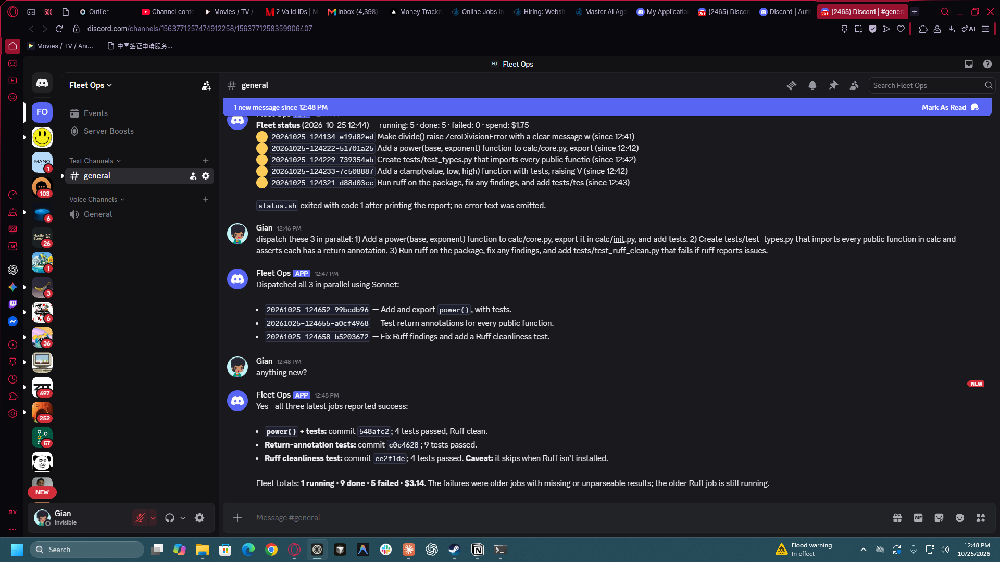

# Demo run — 2026-10-25 (Asia/Singapore)



Timeline, all driven from Discord `#general` in the Fleet Ops server:

| Time | What happened |
|---|---|
| 12:36 | First round trip: Discord → OpenClaw gateway (WSL2) → reply. |
| 12:40 | First bridge job (`dispatch.sh --wait`): headless Claude Code, Sonnet, 12 turns, 54 s, $0.41, tests pass. Found that `git checkout` was missing from the tool allowlist → fixed, branch is now pre-created by the dispatcher. |
| 12:41 | `dispatch: …` from Discord → job id back in 4 s. |
| 12:43 | `run the batch file …` from Discord → **8 agents launched in parallel**, 5 done within 60 s, each on its own `fleet/<id>` branch with a conventional commit. |
| 12:44 | **Bug found under load:** OpenClaw's `exec` kills the WSL wrapper when the command returns; the Windows `claude.exe` child survives and even commits, but nobody writes `status.json`. 5 jobs stuck at "running". Fix: `setsid -f` detachment in `dispatch.sh` + a reconcile pass in `status.sh` (finalize from `result.json`, mark stale jobs failed after `FLEET_STALE_MIN`). |
| 12:47 | `dispatch these 3 in parallel: …` → all 3 survive the fix, finish in ~90 s, commits `548afc2`, `c0c4628`, `ee2f1de`. |
| 12:48 | `anything new?` → agent runs `status.sh --since last` and posts the per-job summary with cost. |

Final tally for the session: **15 jobs, 9 done, 5 failed (all pre-fix kills, correctly reported as failed), 1 stale, $3.14 total.**

Crons registered in OpenClaw:

```
fleet-heartbeat        every 30m        announce -> discord:channel:… (isolated session)
fleet-morning-report   0 7 * * * (SGT)  announce -> discord:channel:… (isolated session)
```

## What I would change before pointing this at a real codebase

1. Replace `cp -r sandbox` with `git worktree add` on the real repo, so branches land in one repo for review.
2. Add a reviewer stage: a second agent runs the tests on each `fleet/*` branch and only then posts ✅.
3. Per-job token budget (`--max-budget-usd`) and a fleet-wide daily cap in `common.sh`.
4. Move the gateway to a $5 VPS so the laptop can sleep; the keep-alive Scheduled Task is a workaround, not a design.
